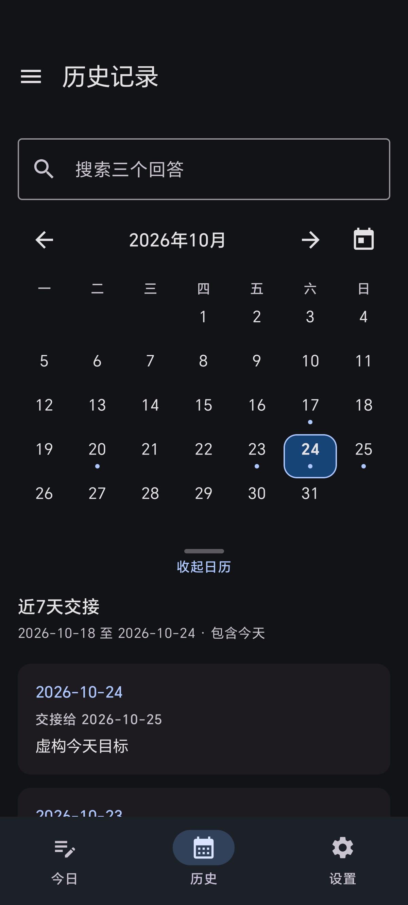
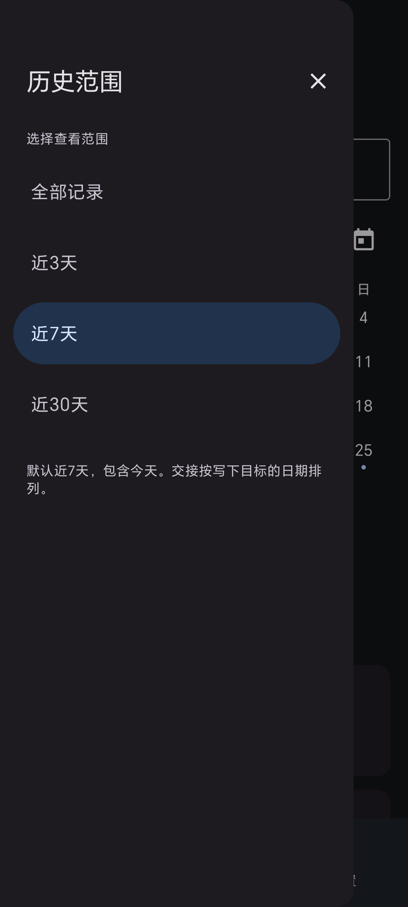
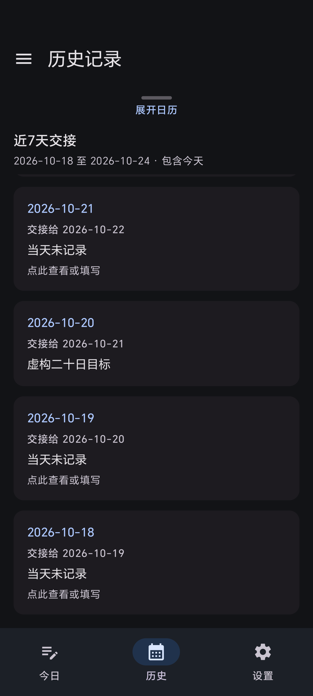
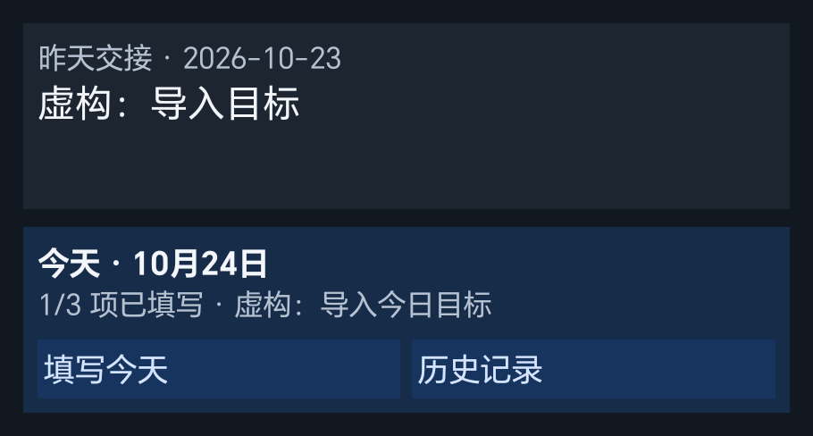
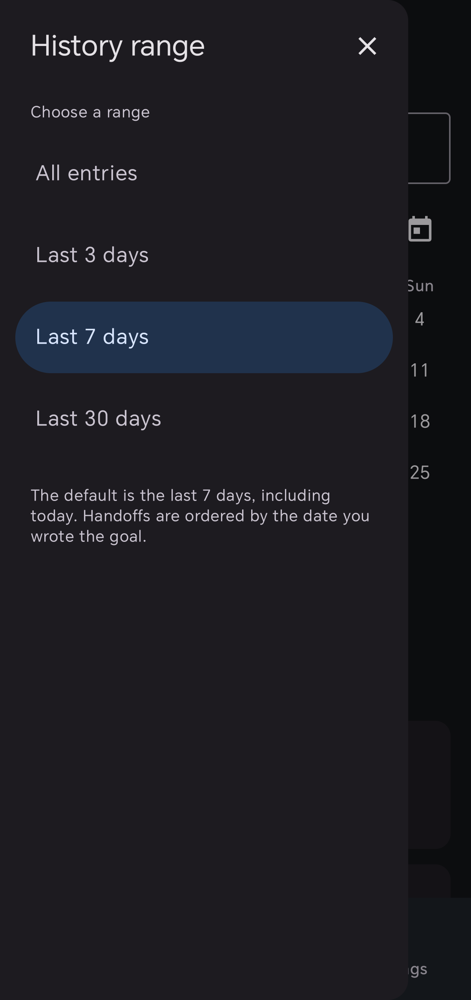
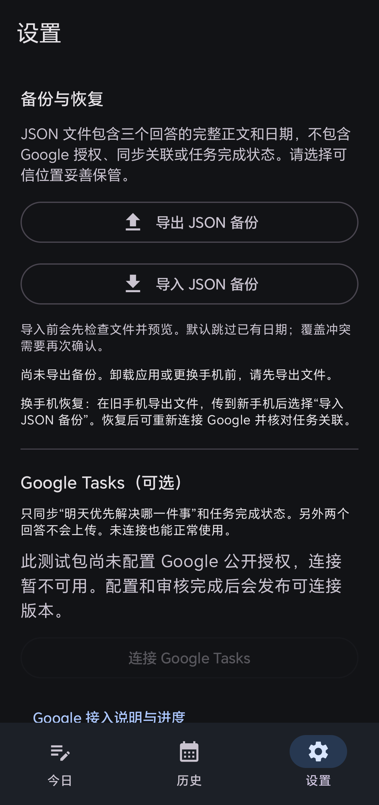

# Daily 3 Minutes / 每天3分钟

[简体中文](README.md) · [English](README.en.md)

A local-first Android learning journal: what did I truly learn today, what remains unclear, and what is the one thing to tackle first tomorrow? Local features need no account. No ads, telemetry, forced timer or streak penalties.

## Download and install

| Section | Content |
| --- | --- |
| APK | The matching version's APK in [GitHub Releases](https://github.com/cui039969-png/cc/releases) |
| Current development version | `0.4.0-beta.1`; testing stage, Google public authorization awaiting configuration and verification |
| Stable release | Not announced; a beta is not presented as completed public Google integration |
| Matching source | The same version's tag and source ZIP; [current source](https://github.com/cui039969-png/cc) |
| Verification | The same release's `SHA256SUMS.txt` and signing notes |
| Requirements | Android 8.0 / API 26 or later; Google connection also requires working Google services |

Actual uploads and installation verification are recorded on the release page and in the [test report](docs/TEST_REPORT.md). Upgrade in place. Do not uninstall an app whose data must be kept to work around a signature mismatch.

## Features and screenshots

- Three daily answers, autosave after about 800 ms, immediate Save and error feedback.
- A calendar and seven daily handoffs. The menu offers all entries or the last 3, 7 or 30 days. Scroll the calendar away and use the handle to restore it.
- Two widget panels: previous handoff above, today's status and writing action below. Other people may see widget content.
- Simplified Chinese, English or system language; system dark theme, large text and landscape navigation; optional daily reminder, off by default.

These are **v0.4.0-beta.1 synthetic-data screenshots from Honor 90**. The Google screen accurately shows that configuration is pending:

| Default history | History menu | Collapsed calendar |
| --- | --- | --- |
|  |  |  |



| English history menu | Backup and Google configuration status |
| --- | --- |
|  |  |

Long-press the home screen → Widgets → Daily 3 Minutes, or use Add to home screen in settings.

## Source and build

Use JDK 17, Android SDK Platform 36 and Build Tools 35.0.0. Set `JAVA_HOME` and `ANDROID_HOME`. See [pinned dependencies](docs/DEPENDENCIES.md).

```powershell
./scripts/doctor.ps1 -Device
./gradlew.bat :app:assembleDebug :app:testDebugUnitTest :app:lintDebug
./scripts/build.ps1 -DeviceTests
```

Use `./gradlew` on Linux/macOS. Use an ASCII directory if Windows Java test workers cannot load classes from a Chinese path. Debug APKs are in `app/build/outputs/apk/debug/`.
Without a Google client, local features still build and the connection UI clearly reports that it is unavailable. See [signing and publishing](docs/PUBLISHING.md) and [maintenance tools](docs/MAINTENANCE_TOOLING.md). Keys and personal data must stay outside the repository.

## Google Tasks

**Optional two-way handoff sync. Public authorization and live Google integration testing are not complete; availability to every Google user is not claimed.**

- Syncs only the third answer and completion, not the other two answers.
- Preview defaults to seven days with an explicit All option. Uses a dedicated `Daily 3 Minutes` list, without importing other lists.
- One-sided edits sync; concurrent wording edits keep both versions. Offline operations stay queued; revoked authorization requires reconnection.
- Cloud deletion keeps the diary. Local deletion or clearing first detaches the link; deleting the cloud task requires separate confirmation.
- Goals over Google's 1,024-character title limit stay local without truncation. Changing a Google task date does not move a diary date.

Google Tasks and the Tasks.org open-source app are separate projects. Sync is not a complete backup. See [Google setup](docs/GOOGLE_TASKS.en.md). Installed users do not configure a developer project; people building their own version must register their own clients and signatures.

## Backup and restore

Settings → Export JSON → choose a trusted location. Transfer the file to a new phone and import it. Import is previewed first, skips existing dates by default and requires a second confirmation to overwrite.

- Includes dates, all three answers and entry timestamps. Excludes Google authorization, sync links, completion, language and reminder preferences.
- JSON is plaintext. No Drive integration or automatic cloud backup in this version. Android system backup is off; export before uninstalling.
- Keeps `schemaVersion: 1`; up to 10 MiB, 10,000 entries and 20,000 Unicode code points per answer.
- Invalid files are rejected in full; failed imports roll back. A failed export can leave an incomplete destination file.

See [backup instructions](docs/BACKUP.md), [JSON format](docs/JSON_PROTOCOL.md) and [privacy](docs/PRIVACY.md).

## Test devices

| Device | System | Purpose |
| --- | --- | --- |
| Honor 90 / REA-AN00 | Android 15 / API 35, MagicOS 9 | In-place upgrades, editing, history, widgets, reminders, migrations and UI; results recorded per version |

Tests use synthetic entries. Device serials and personal journals are not published. v0.3's 54 unit and 37 device tests do not replace new acceptance. The [current report](docs/TEST_REPORT.md) and [known limitations](docs/KNOWN_LIMITATIONS.md) list actual results and untested areas.

## Open source and licenses

| Category | Source and use |
| --- | --- |
| Adapted code | [FrictionFreeDiary](https://github.com/scottwdavis/FrictionFreeDiary), MIT; project, theme and calendar foundation; [upstream license](LICENSE-UPSTREAM) retained |
| Adapted code | [Android Platform Samples](https://github.com/android/platform-samples), Apache-2.0; widget toolbar foundation |
| Open-source dependencies | AndroidX, Kotlin Coroutines and Kotlin Serialization, Apache-2.0 |
| Third-party service components | Google Play services Auth and Google ID under Google terms; optional integration, not described as entirely open-source dependencies |
| Product references | Tasks.org, Calendar, Compose Samples and others; GPL projects are experience references, with no GPL implementation copied |

Original additions use [Apache-2.0](LICENSE); upstream MIT code is not relicensed. [NOTICE](NOTICE.md) and the [source review](docs/OPEN_SOURCE_REVIEW_0_4_0.md) list sources, versions and uses. Windows maintenance tools are not Android runtime dependencies.

## Updates and contributing

[Changelog](CHANGELOG.md) · [Contributing](CONTRIBUTING.md) · [Issues](https://github.com/cui039969-png/cc/issues) · [Privacy issues](SECURITY.md)

Releases verify builds, tests, signatures, devices and downloaded files. Google configuration, review, live integration and untested areas are reported honestly. A workflow file is not proof of successful remote CI; inspect actual runs.
