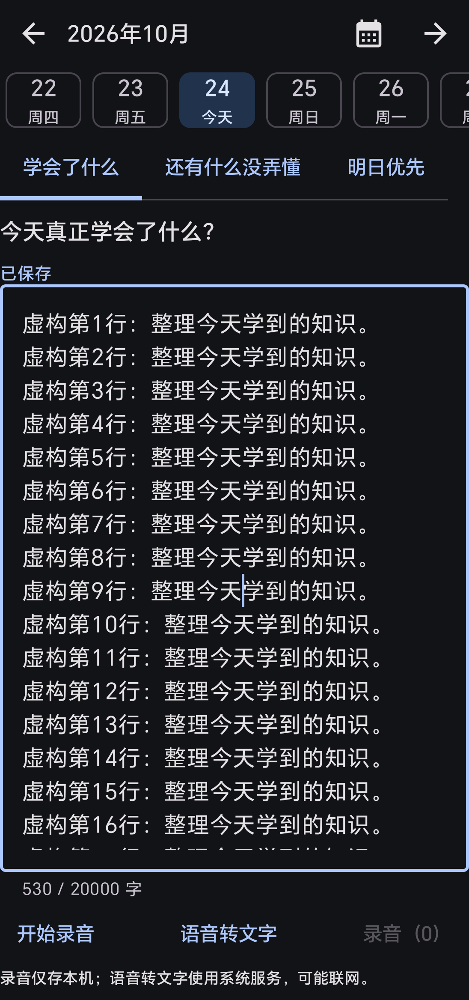
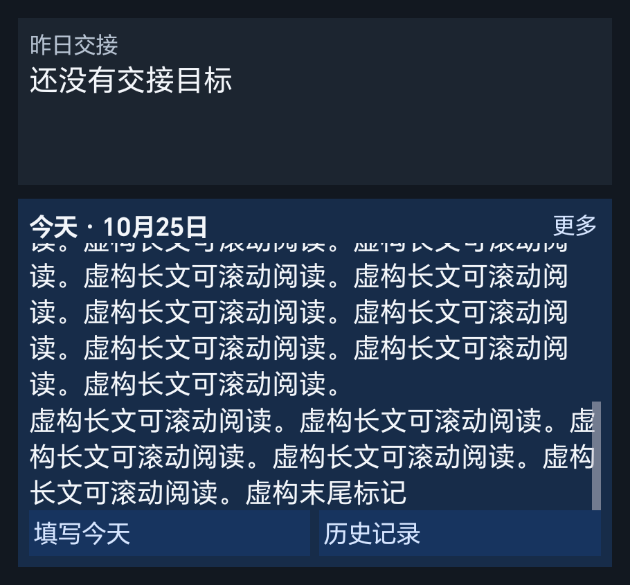

# 每天3分钟 / Daily 3 Minutes

[简体中文](README.md) · [English](README.en.md)

本地优先的 Android 学习回顾应用，每天记录：今天真正学会了什么、还有什么没弄懂、明天优先解决哪一件事。本地功能无需账号，无广告、无遥测、无强制计时或连续打卡惩罚。

## 下载安装

| 栏目 | 内容 |
| --- | --- |
| 安装包 | [v0.5.0-beta.1 测试版 APK](https://github.com/cui039969-png/cc/releases/download/v0.5.0-beta.1/daily-3-minutes-0.5.0-beta.1.apk)；[发行说明与校验值](https://github.com/cui039969-png/cc/releases/tag/v0.5.0-beta.1) |
| 当前测试版本 | `0.5.0-beta.1` 已发布；Google 公开授权尚待配置及验证 |
| 正式版 | 尚未宣布；不会把测试版标成 Google 已公开可用的正式版 |
| 对应源码 | [本版源码 ZIP](https://github.com/cui039969-png/cc/releases/download/v0.5.0-beta.1/daily-3-minutes-0.5.0-beta.1-source.zip)；[版本标签](https://github.com/cui039969-png/cc/tree/v0.5.0-beta.1)；[当前源码](https://github.com/cui039969-png/cc) |
| 核验 | 同一发行页的 `SHA256SUMS.txt` 和签名说明 |
| 要求 | Android 8.0 / API 26 以上；Google 连接另需可用 Google 服务 |

资产是否已上传、是否已安装验证，以发行页和[测试报告](docs/TEST_REPORT.md)为准。覆盖安装升级；不要通过卸载来解决需要保留记录的签名问题。

## 功能截图

- 每日三问分别打开独立长文编辑页；横向日期、月份与问题页签切换，切换前保存。
- 本机录音附件、回放和确认删除；系统语音转文字先预览再追加。
- 约 800ms 自动保存、即时保存及失败提示。
- 历史默认月历＋近七天交接；三横菜单切换全部、近三天、七天、三十天。上滑收起日历，点击横条展开。
- 桌面上下双栏：过去交接目标、今天多行正文与填写入口；下栏可上下滑动，“更多”进入录音和转文字所在的问题页。组件内容可能被旁人看到。
- 简体中文、英文、跟随系统；系统深色主题、大字体、横屏侧栏；可选每日提醒默认关闭。

以下新编辑页和滚动组件为 **v0.5.0-beta.1 荣耀90合成截图**。

| 独立编辑页 | 组件滑动后的后段正文 |
| --- | --- |
|  |  |

[日期、录音与编辑操作说明](docs/EDITING_AND_AUDIO.md)。下列历史、菜单和Google截图保留自v0.4，相关布局继续支持；Google仍待配置：

| 默认历史 | 历史菜单 | 日历收起 |
| --- | --- | --- |
|  |  |  |


| 英文历史菜单 | 备份与Google配置状态 |
| --- | --- |
|  |  |

添加组件：长按桌面空白处 → 小组件 → 每天3分钟，或使用设置里的“添加到桌面”。

## 源码构建

需要 JDK 17、Android SDK Platform 36、Build Tools 35.0.0，配置 `JAVA_HOME`、`ANDROID_HOME`。固定版本见[依赖说明](docs/DEPENDENCIES.md)。

```powershell
./scripts/doctor.ps1 -Device
./gradlew.bat :app:assembleDebug :app:testDebugUnitTest :app:lintDebug
./scripts/build.ps1 -Synthetic -DeviceTests
```

Linux/macOS 使用 `./gradlew`。Windows 中文路径遇到 Java 测试类加载问题时使用英文目录。Debug APK 位于 `app/build/outputs/apk/debug/`。
未配置 Google 客户端时仍能构建本地功能，连接入口会明确显示不可用。[正式签名与发布](docs/PUBLISHING.md)、[维护工具](docs/MAINTENANCE_TOOLING.md)分别说明。密钥和个人数据不得进入仓库。

## Google Tasks

**可选双向交接任务同步。当前公开授权和真实 Google 联调尚未完成，不能宣称所有 Google 用户已可连接。**

- 仅同步第三个回答与完成状态，不上传另外两个回答。
- 首次预览默认近七天，可主动选全部；使用独立 `Daily 3 Minutes` 列表，不导入其他列表。
- 单边修改同步，双方同时修改文字则保留两份；断网保留队列，授权失效提示重新连接。
- 云端删除不删除日记；本地删除或清空先解除关联，云端任务另行确认删除。
- 标题超过 Google 的 1024 字符限制时留在本地，不截断上传。Google 调整任务日期不移动日记日期。

Google Tasks 服务和 Tasks.org 开源应用是两个不同项目。同步不等于完整备份。详见 [Google 接入说明](docs/GOOGLE_TASKS.md)；普通安装用户无需自己配置开发项目，自行构建者需要自己的客户端和签名登记。

## 备份恢复

有录音时：设置 → 导出完整备份（文字和录音）→ 选择可信位置。换手机传输ZIP后选择“恢复完整备份”。只需文字时可继续使用JSON。先预览，默认跳过已有日期，覆盖再次确认。

- 完整ZIP包含文字和录音，最多1000段、音频合计512MiB；JSON仅包含文字。
- 包含日期、三个完整回答和记录时间；不包含 Google 授权、同步关联、完成状态、语言和提醒偏好。
- JSON 为明文；本版不接入 Drive，不提供自动云备份。系统自动备份关闭，卸载前主动导出。
- 保持 `schemaVersion: 1`；上限 10 MiB、10000 条、每个回答 20000 个 Unicode 码点。
- 非法文件整体拒绝，失败事务回滚。导出失败可能留下不完整目标文件。

详见[备份操作](docs/BACKUP.md)、[JSON 格式](docs/JSON_PROTOCOL.md)、[隐私说明](docs/PRIVACY.md)。

## 测试设备

| 设备 | 系统 | 用途 |
| --- | --- | --- |
| 荣耀 90 / REA-AN00 | Android 15 / API 35，MagicOS 9 | 覆盖安装、编辑、历史、组件、提醒、迁移及界面；结果按版本记录 |

使用合成记录，不公开序列号和个人日记。v0.3 的 54 项单元测试与 37 项设备测试不能替代新版本验收。[当前报告](docs/TEST_REPORT.md)和[已知限制](docs/KNOWN_LIMITATIONS.md)列明实际结果与未测范围。

## 开源与许可证

| 类别 | 来源与用途 |
| --- | --- |
| 改编代码 | [FrictionFreeDiary](https://github.com/scottwdavis/FrictionFreeDiary)，MIT，工程、主题、月历基础；[上游许可](LICENSE-UPSTREAM)保留 |
| 改编代码 | [Android Platform Samples](https://github.com/android/platform-samples)，Apache-2.0，组件工具栏基础 |
| 实际开源依赖 | AndroidX、Kotlin Coroutines、Kotlin Serialization，Apache-2.0 |
| 第三方服务组件 | Google Play services Auth、Google ID，按 Google 条款提供可选接入，不标为全部开源依赖 |
| 体验参考 | Tasks.org、Calendar、Compose Samples 等；GPL 项目仅参考体验，未移植 GPL 代码 |

原创新增代码为 [Apache-2.0](LICENSE)，上游 MIT 不被重新授权。[NOTICE](NOTICE.md)与[引用清单](docs/OPEN_SOURCE_REVIEW_0_5_0.md)列明来源、版本及用途。Windows 维护工具不属于手机运行依赖。

## 更新及贡献

[变更记录](CHANGELOG.md) · [贡献指南](CONTRIBUTING.md) · [问题反馈](https://github.com/cui039969-png/cc/issues) · [隐私问题](SECURITY.md)

发布依次验证构建、测试、签名、真机与下载文件。Google 配置和审核、真实联调、未测项目如实标注。CI 文件存在不代表远程 CI 已通过，以实际运行记录为准。
